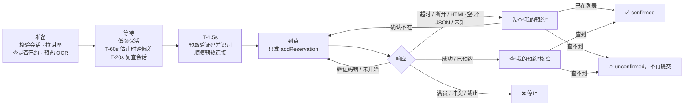

<div align="center">

# seu-lecture-cli

**东南大学本科生人文素质讲座预约命令行工具（非官方）**

低延迟 · 结果可核验 · 适合 Agent 调用

[](https://github.com/wynter-yaxley/seu-lecture-cli/actions/workflows/ci.yml)


简体中文 | [English](README-EN.md)

</div>

> [!WARNING]
> 本项目是**非官方**的个人开源工具，与东南大学及其信息化部门无任何关联。
> 请遵守学校的系统使用规定，只为**自己的账号**预约**自己会去听**的讲座。
> 工具不保证一定能约到，学校接口随时可能变化。使用风险由使用者自行承担。

---

## 目录

- [它能做什么](#它能做什么)
- [安装](#安装)
- [五分钟上手](#五分钟上手)
- [命令一览](#命令一览)
- [预约任务是怎么跑的](#预约任务是怎么跑的)
- [Agent / 脚本集成](#agent--脚本集成)
- [配置文件](#配置文件)
- [性能数据](#性能数据)
- [验收状态与已知限制](#验收状态与已知限制)
- [安全设计](#安全设计)
- [开发](#开发)
- [致谢与来源](#致谢与来源)

## 它能做什么

| | |
|---|---|
| 🎯 **对接本科生系统** | 使用本科生模块 `modules/hdyy_bk/`，不会误用研究生接口 `modules/hdyy/` |
| ⏱️ **精确定时** | 常驻进程提前预热：登录、连接、OCR 模型和验证码都在开放前准备好，到点只发一个请求 |
| 🕐 **时钟校准** | 用 HTTP `Date` 头的秒跳变估计服务器时钟偏差，并给出误差范围；不假设 `Date` 头有毫秒精度 |
| ✅ **结果核验** | 接口返回“成功”之后，还要在“我的预约”列表里查到才算成功；状态不明时**先查再说**，不会盲目重复提交 |
| 🤖 **Agent 友好** | `--json` 输出稳定的 JSON / JSONL，有 schema 版本、统一错误码和退出码 |
| 🔐 **凭据安全** | 密码和会话只存进系统凭据管理器（Windows 凭据管理器 / macOS 钥匙串 / Secret Service）；保持 TLS 证书校验 |
| 🧪 **可复现的测试** | 内置 Mock 校园系统，覆盖登录、短信二次验证、满员、验证码错误、超时、结果不确定等场景 |

## 安装

需要 Python 3.11+，推荐用 [uv](https://docs.astral.sh/uv/)。

```bash
# 作为全局命令安装（推荐）
uv tool install git+https://github.com/wynter-yaxley/seu-lecture-cli

# 或者从源码运行
git clone https://github.com/wynter-yaxley/seu-lecture-cli
cd seu-lecture-cli
uv sync
uv run seu-lecture --help
```

> [!NOTE]
> 访问学校系统需要**校园网**，或先连好学校 VPN 客户端。`seu-lecture doctor` 可以帮你检查。
> 验证码识别依赖 [ddddocr](https://github.com/sml2h3/ddddocr)，首次安装需要下载约 150 MB 依赖（含 onnxruntime / OpenCV）。

## 五分钟上手

```bash
# 1. 环境自检：依赖、凭据存储、校园网连通性、时钟偏差
seu-lecture doctor

# 2. 登录（交互输入密码；陌生设备会提示输入短信验证码）
seu-lecture auth login -u 213xxxxxx

# 3. 看看有哪些讲座
seu-lecture list
seu-lecture list -k 心理 --available

# 4. 查看详情（ID 可以只写前 6 位以上的唯一前缀）
seu-lecture show 8f1c2d

# 5. 先演练一遍：完整走预热、定时、取验证码和识别，但不提交
seu-lecture reserve 8f1c2d --dry-run

# 6. 正式预约：默认在讲座的“预约开始时间”触发，会先请你确认
seu-lecture reserve 8f1c2d
#    也可以手动指定开放时间
seu-lecture reserve 8f1c2d --at 2026-10-22T19:00:00+08:00

# 7. 查看结果
seu-lecture reservations
seu-lecture status
```

`reserve` 是一个**常驻进程**，建议在开放前几分钟启动，并让它一直运行到结束（可以 `Ctrl+C` 中止）。

## 命令一览

| 命令 | 作用 | 是否写入学校系统 |
|---|---|---|
| `seu-lecture auth login` | 登录统一身份认证，支持短信二次验证 | 否 |
| `seu-lecture auth status` | 账号、凭据保存情况、会话是否有效 | 否 |
| `seu-lecture auth logout` | 清除保存的密码和会话 | 否 |
| `seu-lecture list` | 讲座列表（`-k` 关键词，`--available` 只看还能约的） | 否 |
| `seu-lecture show <id>` | 讲座详情（`--raw` 附带接口原始字段） | 否 |
| `seu-lecture reservations` | 我的预约 | 否 |
| `seu-lecture reserve <id>` | 定时预约任务 | **是**（需确认或 `--yes`） |
| `seu-lecture status` | 最近一次 / 正在运行的预约任务状态 | 否 |
| `seu-lecture doctor` | 环境自检（`--offline` 只做本地检查，`--ocr` 测量模型加载） | 否 |
| `seu-lecture benchmark --mock` | 本地 Mock 性能基准，输出 p50/p95/p99 | 否（只访问 127.0.0.1） |

所有命令都支持 `--help` 和 `--json`。

`reserve` 的常用参数：

| 参数 | 默认 | 说明 |
|---|---|---|
| `--at` | 讲座的预约开始时间 | 开放时间，ISO 8601；不带时区时按北京时间处理 |
| `--offset-ms` | `50` | 希望请求在开放后多少毫秒**到达**服务器。太小容易遇到“未开始” |
| `--clock` | `auto` | `auto`：本机与服务器 Date 不一致时两边都照顾（见下文）；`server`：只信服务器估计；`local`：只信本机时钟 |
| `--no-prefetch` | 关 | 不在开放前预取验证码（如果发现预取的验证码会失效，就打开这个开关） |
| `--max-attempts` | `8` | 提交次数上限（1–20） |
| `--dry-run` | 关 | 完整演练，不提交 |
| `--yes` / `-y` | 关 | 明确授权写操作；非交互环境必须加 |

## 预约任务是怎么跑的



几个关键设计：

- **到点的关键路径上只有一次 HTTP 请求。** 登录、讲座查询、OCR 模型加载、验证码获取与识别都在开放前完成；关键路径上不读写磁盘、不刷新界面、暂停 GC，事件先缓存，结束后再输出。
- **分阶段等待。** 远离目标时分块 `sleep`，每次醒来检查墙钟和单调时钟是否发生跳变（休眠唤醒、NTP 调整）；最后 2 秒改用 `perf_counter_ns()` 单调时钟，再用短 sleep 逼近，最后约 1.5 ms 才自旋，CPU 几乎全程空闲。
- **时钟偏差估计。** `Date` 头只有秒级精度。一个样本只能说明“服务器时间在 `[D, D+1)` 秒之间”，但把多个样本的发送时刻对准预测的秒跳变点后求交集，误差可以收敛到 RTT 量级。估计值总是带误差范围，样本自相矛盾（比如负载均衡后面的机器时钟不一致）时直接放弃。
- **两套时钟不一致时不赌。** 哪个时钟决定“开放”很难从外部判断：`Date` 头可能来自前置网关，而不是业务服务器。`auto` 模式下，只要两者的差异超出估计误差，就安排两个候选时刻：较早的候选最多试探 2 次，返回“未开始”就等到另一个候选时刻，用剩余次数正式提交；`--max-attempts` 是整个任务所有候选加起来的上限。按服务器时钟算出的候选时刻取误差区间的**最晚端**，不会因为估计偏差而提前到达。
- **延迟补偿。** 用预热期间同一连接上的 RTT 中位数，提前半个 RTT 发出请求，使请求大致在 `开放时间 + offset_ms` 到达服务器。
- **有限重试。** 验证码错误立即换新验证码重试；“未开始”在 3 秒窗口内重试；“请求过于频繁”或 HTTP 429 最多退避一次（遵守 `Retry-After`，上限 60 秒，超过就直接返回 `rate_limited`）；所有重试都受 `--max-attempts` 和最小间隔 200 ms 约束，绝不无限请求或并发轰炸。
- **不重复提交。** 请求超时、连接断开、服务器 5xx、返回 HTML / 空内容 / 损坏的 JSON、或者看不懂的响应，一律先查“我的预约”（需要时在核验过程中重新登录），绝不“重新登录后直接重提”：已在列表就是成功；**完整读到**列表且确认不在，才允许再提交一次；列表缺字段、为 null、返回业务错误、或分页读到上限仍未读完，都不算“不在列表”，此时停下来报告 `unconfirmed`，交给你人工确认。

## Agent / 脚本集成

加上 `--json` 后，stdout 只输出 UTF-8 JSON，不带 ANSI 颜色，也不会混入日志。

**普通命令** 只输出一个 JSON 对象：

```json
{"schema_version":"1","ok":true,"command":"list","data":[{"id":"8f1c…","title":"…","reserve_start":"2026-10-22T19:00:00+08:00","remaining":12,"state":"not_open"}]}
```

```json
{"schema_version":"1","ok":false,"command":"list","error":{"code":"AUTH_REQUIRED","message":"no account configured","retryable":false},"exit_code":3}
```

**`reserve --json`** 逐行输出 JSONL 事件，最后一行一定是 `result` 或 `error`：

```jsonl
{"schema_version":"1","ts":"2026-10-22T18:58:01.120+08:00","event":"phase","phase":"prepare"}
{"schema_version":"1","ts":"…","event":"prepared","lecture":{…},"at":"2026-10-22T19:00:00+08:00","ocr_warmup_ms":312.4}
{"schema_version":"1","ts":"…","event":"clock","offset_ms":-12.5,"error_ms":9.8,"applied_offset_ms":0.0}
{"schema_version":"1","ts":"…","event":"armed","fire_at":1792321200.043,"rtt_ms":14.2}
{"schema_version":"1","ts":"…","event":"phase","phase":"fire","late_ms":0.004}
{"schema_version":"1","ts":"…","event":"attempt","n":1,"reply":"success","message":"预约成功"}
{"schema_version":"1","ts":"…","event":"result","outcome":"confirmed","attempts":1,"timings":{…},"metrics":{…}}
```

`outcome` 的取值：`confirmed`、`already_reserved`、`dry_run`、`full`、`conflict`、`closed`、`not_open`、`rate_limited`、`unconfirmed`、`failed`、`aborted`。

**退出码：**

| 码 | 含义 |
|---|---|
| 0 | 成功（含 confirmed / already_reserved / dry_run） |
| 1 | 内部错误，或预约因未分类原因失败 |
| 2 | 用法或配置错误 |
| 3 | 需要登录 / 认证失败 / 需要短信验证码 |
| 4 | 网络错误或超时 |
| 5 | 学校接口返回了无法识别的内容 |
| 6 | 讲座不存在 |
| 7 | 已有另一个预约任务在运行 |
| 10 | 预约被拒：满员、时间冲突、已截止、未开放、请求过于频繁 |
| 11 | 结果无法确认，请运行 `seu-lecture reservations` 检查 |
| 12 | 需要确认（写操作必须显式加 `--yes`） |
| 130 | 被中断 |

**推荐的 Agent 用法：** Agent 负责查询、创建任务和读取状态；精确定时和最终请求由独立的 `reserve` 进程完成。

```bash
seu-lecture list --json                         # 查询
seu-lecture reserve <id> --yes --json > task.jsonl &   # 用户明确授权后，在后台启动任务
seu-lecture status --json                       # 随时读取任务状态
```

非交互登录：`--password-stdin` 从标准输入读密码；遇到 `SMS_REQUIRED`（退出码 3）时，短信已经发出，带上 `--sms-code <验证码>` 再运行一次即可。

业务逻辑都在 `seu_lecture.api.LectureService` 里，以后接 MCP 时可以直接调用这些方法，不需要再去 shell 里执行 CLI。

## 配置文件

配置文件是可选的，位置如下（也可以用 `--config` 指定）：

- Windows：`%APPDATA%\seu-lecture\config.toml`
- macOS：`~/Library/Application Support/seu-lecture/config.toml`
- Linux：`~/.config/seu-lecture/config.toml`

```toml
[network]
connect_timeout = 5
read_timeout = 10

[captcha]
# length = 4      # 已知验证码位数时填上，可以在识别出错时尽早换一张
# digits = true   # 验证码只有数字时打开

[reserve]
offset_ms = 50
clock = "auto"
prefetch_captcha = true
captcha_lead_ms = 1500
max_attempts = 8

[protocol]
module = "hdyy_bk"       # 本科生模块
submit_format = "form"   # 学校改用 paramJson 编码时改成 "paramJson"
```

环境变量：`SEU_LECTURE_USERNAME`、`SEU_LECTURE_PASSWORD`（适合不能使用凭据管理器的环境）、`SEU_LECTURE_HOME`（把配置和状态都放到同一个目录）。

状态文件（`account.json` 存用户名和随机设备指纹，`status.json` 存任务状态）放在 `%LOCALAPPDATA%\seu-lecture` 或 `~/.local/state/seu-lecture`，**里面没有密码和 Cookie**。

## 性能数据

测试环境：WSL2（Linux 6.6）· Python 3.11.15 · httpx 0.28.1；Mock 服务端在 127.0.0.1，模拟处理时延 2 ms；
命令 `seu-lecture benchmark --mock -n 200 --ocr real --e2e 20`。单位：毫秒。端到端（E2E）行是完整的 `reserve` 任务，使用与 `--ocr` 相同的识别器；验证码在开放前预取，所以 OCR 不在“触发 → 响应”的路径上。

> [!NOTE]
> 下表全部来自**本地 Mock**，用来衡量客户端自身的开销和调度精度，**不代表真实校园网下的预约速度**，也不承诺抢课成功率。

| 类别 | 指标 | p50 | p95 | p99 | 样本数 |
|---|---|---:|---:|---:|---:|
| 本地调度误差 | 定时触发误差（对照墙钟） | 0.014 | 0.026 | 0.046 | 200 |
| 服务器耗时 | `addReservation` 服务端处理（`Server-Timing`） | 2.178 | 2.293 | 2.354 | 200 |
| 网络 + 服务器 | `addReservation` 往返 | 3.342 | 3.779 | 4.055 | 200 |
| 客户端开销 | 往返 − 服务端处理（含回环和 Mock 的 HTTP 框架） | 1.140 | 1.546 | 1.884 | 200 |
| OCR | ddddocr 单次识别（模型已预热） | 5.127 | 6.243 | 6.719 | 200 |
| 关键路径 | 触发 → 预约响应（**预取验证码**） | 3.439 | 3.897 | 4.182 | 200 |
| 关键路径 | 触发 → 预约响应（到点才取验证码） | 11.751 | 13.165 | 13.644 | 200 |
| 端到端 | 完整任务：触发 → 首个响应 | 3.939 | 4.406 | 4.629 | 20 |
| 端到端 | 完整任务：触发 → “我的预约”核验完成 | 7.270 | 8.320 | 8.360 | 20 |
| 端到端 | 服务端收到请求时刻 − 开放时刻（目标 +20 ms） | 21.856 | 22.255 | 22.356 | 20 |

从数据能得出的结论：

- **预取验证码**把关键路径从约 11.8 ms 降到约 3.4 ms：省掉了一次往返和一次 OCR。在真实网络中，省下的就是“一个 RTT + 约 5 ms OCR”。
- **调度误差在 0.1 ms 以内**，和网络抖动相比可以忽略。
- **OCR 冷启动约 1.4 s**（导入 + 加载模型），所以必须放在准备阶段。
- **真实网络单次只读探测**（本机在校园网内，各 1 个样本，不是分位数）：到 ehall 的 TCP 连接 15 ms、TLS 握手完成 24 ms；到 auth 的 TCP 连接 22 ms、TLS 握手完成 39 ms。新建 HTTPS 连接的代价远大于 Mock 里的约 1 ms，所以开放前要先把连接预热好。
- **HTTP 客户端公平对比**（同一个 Mock、keep-alive、交替执行 2000 轮，`benchmarks/compare_http_clients.py`）：httpx p50/p95/p99 = 0.748 / 0.996 / 1.128 ms，requests = 0.832 / 1.037 / 1.209 ms。差距不到 0.1 ms。选 httpx 是因为它有 MockTransport、分项超时和可配置的 keep-alive 过期时间，而不是因为更快。
- 没有实测证据表明并发或异步能带来收益，所以保持单线程同步实现。

## 验收状态与已知限制

| 项目 | 状态 |
|---|---|
| Mock 环境下的登录、短信二次验证、查询、预约、核验、异常处理 | ✅ 自动化测试覆盖 |
| Windows / Linux CI（Ruff + pytest） | ✅ 已配置 GitHub Actions |
| 真实系统：未登录状态下的连通性、TLS 证书校验、未登录跳转 CAS | ✅ 已做低频只读检查 |
| 真实系统：CAS 登录、讲座列表字段、“我的预约”字段 | ⏳ **尚未用真实账号验证** |
| 真实系统：`vcode.do` 验证码格式、OCR 识别率 | ⏳ **尚未验证** |
| 真实系统：`addReservation.do` 的参数编码、各种响应文案 | ⏳ **尚未验证**（从未提交过真实预约） |
| 预取验证码在开放时刻是否仍然有效 | ⏳ **未知**，可用 `--no-prefetch` 关闭 |

> [!IMPORTANT]
> **实测发现（2026-10-21）：** 从校园网访问时，所有 `*.seu.edu.cn` 站点（ehall、auth、www、jwc、mirrors 等）返回的 HTTP `Date` 头都比真实时间**快约 6 分 15 秒**；
> 但本机时钟、百度/Cloudflare 的 `Date`、校园 NTP（`ntp.seu.edu.cn`、`time.seu.edu.cn`）以及公网 NTP 二者互相一致（误差 < 20 ms）。
> 这说明 `Date` 很可能由前置网关生成，**不能直接当作预约系统的时钟**。业务服务器到底用哪个时钟判断“开放”，目前还未实测，所以 `auto` 模式会两个候选时刻都照顾（见上文）。
> 首次真实预约会告诉我们答案：如果事件流里出现 `candidate_not_open`，就说明业务服务器用的是正确时间。

已知限制：

- 学校接口没有公开文档。接口路径和字段来自公开项目的交叉比对（见[致谢](#致谢与来源)），未知部分集中放在 `core/client.py` 和 `core/lecture.py`，学校改版时只需要改这两处。
- 不支持校外 WebVPN 网关登录，请在校园网内使用，或者先连上学校的 VPN 客户端。
- CAS 要求图形验证码时（通常是连续输错密码后），需要先在浏览器里登录一次。
- Windows 凭据管理器单条记录有大小限制，会话 Cookie 太大时不会被缓存，每次命令都会重新登录（不影响 `reserve`）。
- 没有凭据管理器的 Linux/WSL 环境不会保存任何东西，需要每次输入密码或设置 `SEU_LECTURE_PASSWORD`。

## 安全设计

- 不使用 `verify=False`，所有请求都校验 TLS 证书；只允许访问 `auth.seu.edu.cn` 和 `ehall.seu.edu.cn`，学校返回的 `http://` 跳转会被升级为 `https://`。
- 密码在客户端用 CAS 下发的 RSA 公钥加密后才发送；密码和会话只保存在系统凭据管理器中，没有安全存储时一律不保存。
- 输出和日志中不包含密码、Cookie、CAS ticket，也不包含验证码图片或识别结果。
- 预约是唯一的写操作，必须交互确认，或者显式传 `--yes`。
- 同一时间只允许一个预约任务（锁文件保护）。

## 开发

```bash
uv sync                      # 安装依赖（含 dev 组）
uv run pytest                # 测试（全部基于 Mock，不访问学校系统）
uv run ruff check .          # 静态检查
uv run seu-lecture benchmark --mock          # 本地性能基准
uv run python benchmarks/compare_http_clients.py   # httpx 与 requests 公平对比
```

代码结构：

```
src/seu_lecture/
├── cli.py          # Typer 命令行入口（只做参数解析和渲染）
├── api.py          # 与前端无关的业务 API（以后的 MCP 适配器直接调用这里）
├── config.py       # 配置、路径、状态文件、任务锁
├── output.py       # JSON / JSONL / 终端输出、退出码
├── benchmark.py    # benchmark --mock
├── mock.py         # Mock 校园系统（测试与基准共用）
└── core/           # 核心逻辑，不依赖 Typer / Rich
    ├── auth.py     # CAS 登录、短信二次验证、系统凭据存储
    ├── client.py   # HTTP 客户端 + 本科生接口协议适配
    ├── lecture.py  # 讲座 / 预约数据解析与筛选
    ├── clock.py    # 时钟偏差估计、分阶段调度
    ├── captcha.py  # 验证码提取与 OCR
    ├── reserve.py  # 预约状态机与结果核验
    ├── metrics.py  # 延迟统计
    └── errors.py   # 错误类型与错误码
```

## 致谢与来源

本项目是**独立实现**，没有复制下列项目的代码；它们公开的接口信息帮助我们交叉核对了协议：

| 项目 | 参考内容 | 许可证 |
|---|---|---|
| [Warma10032/fetch_lecture](https://github.com/Warma10032/fetch_lecture)（源自 zhjcreator/fetch_lecture） | 本科生模块 `hdyy_bk` 的接口路径与字段 | MIT |
| fetch_lecture 中的 `seu_auth.py`（Golevka2001） | CAS 登录流程 | GPL-3.0（**未复制代码**，只参考公开协议） |
| [MuZiJin701/seu-lecture-reserve-http](https://github.com/MuZiJin701/seu-lecture-reserve-http) / [seu_lecture_reserve](https://github.com/MuZiJin701/seu_lecture_reserve) | CAS 响应码、研究生模块字段语义（用于确认本科生与研究生接口的差异） | 未声明 |
| [candyb0x/SEU-Lecture-Revenge](https://github.com/candyb0x/SEU-Lecture-Revenge) | 预约响应文案（满员、冲突、频繁） | 未声明 |
| [cli/cli](https://github.com/cli/cli)、[astral-sh/uv](https://github.com/astral-sh/uv) | 命令组织、`--json` 输出与退出码约定 | MIT / Apache-2.0 |

## 许可证

[MIT](LICENSE)
