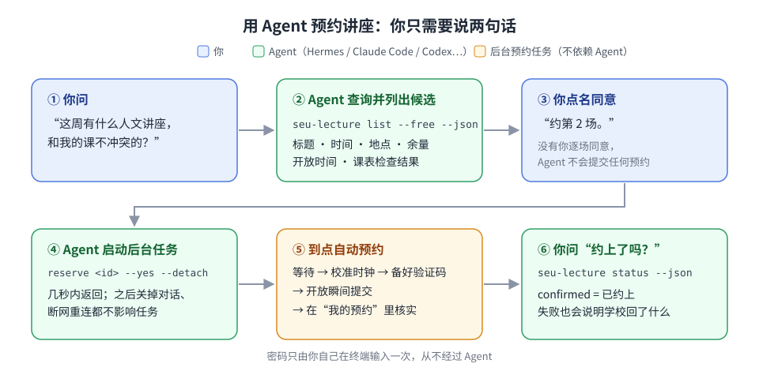
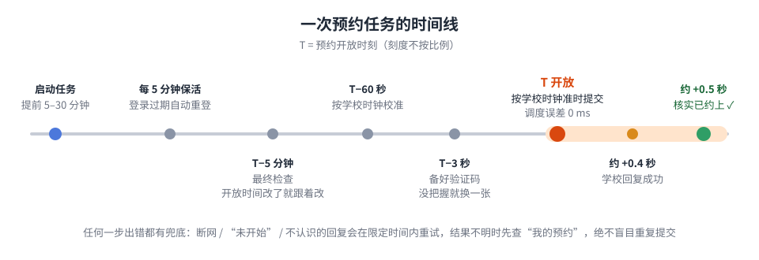

<div align="center">

# seu-lecture-cli

**东南大学本科生人文素质讲座预约工具（非官方）**

对照课表挑讲座 · 开放瞬间自动预约 · 交给 AI Agent 一句话搞定

[](https://github.com/wynter-yaxley/seu-lecture-cli/actions/workflows/ci.yml)


简体中文 | [English](README-EN.md)

</div>

> [!WARNING]
> 本项目是**非官方**的个人开源工具，与东南大学无关。请遏守学校规定，只用**自己的账号**预约**自己会去听**的讲座——
> 约上不去可能被记违约。学校接口随时可能变化，不保证一定约得到。

## 为什么用它

热门讲座开放后几秒就约满，手动刷新、看验证码、点提交很难抢得过。这个工具替你：

- 先把和你**上课时间冲突**的讲座筛掉；
- 在**开放的那一瞬间**自动提交（验证码提前识别好）；
- 在“我的预约”里**查到了才算成功**。

它是一个命令行工具，但你**不需要会用命令行**：装好之后，直接跟你的 AI Agent（Hermes、Claude Code、Codex 等）说话就行。



## 功能一览

| 功能 | 说明 |
|---|---|
| 📚 查讲座 | 标题、举办时间、地点、余量、何时开放预约；可按关键词筛选 |
| 🗓️ 对照课表 | 自动读取你的课表（含单双周、调课、停课、补课），标出每场讲座是“不冲突 / 冲突 / 无法判断” |
| ⏱️ 定时预约 | 提前启动后自动等待，按**学校服务器的时钟**在开放瞬间提交，误差约 0.1 秒内 |
| 🔢 验证码 | 本地离线识别（不上传任何服务）；开放前就准备好一张“有把握”的，识别错了立刻换一张重交 |
| ✅ 结果核实 | 只有在“我的预约”里查到才算成功；结果不明时先查再说，**绝不重复预约** |
| 🛡️ 容错 | 短暂断网、学校时钟偏差、登录过期、开放时间被临时改动、服务器限流，都有对应处理 |
| 🌙 后台运行 | 一条命令转到后台，关掉对话、Agent 重启都不影响；多场讲座可以同时挂着 |
| 🔍 满员捡漏（可选） | 没抢到时继续监视余量，有人退约立即补交；默认关闭，避免频繁请求 |
| 🤖 为 Agent 设计 | 自带 Agent Skill（规定了 Agent 必须遵守的规则）；所有命令都有稳定的 JSON 输出 |
| 🔐 安全 | 密码只由你自己输入，存在系统凭据管理器；Agent 接触不到你的密码 |

## 开始之前，你需要

- 一台能一直开着的电脑（Windows / macOS / Linux / WSL 都行），在**校园网**内，或已连上学校 VPN 客户端；
- 你的一卡通号和统一身份认证密码；
- （推荐）一个能执行命令的 AI Agent，比如 [Hermes](https://github.com/NousResearch/hermes-agent)、[Claude Code](https://docs.claude.com/en/docs/claude-code)、[Codex](https://github.com/openai/codex)。

## 快速开始：交给 Agent（推荐）

一共三步，第 2 步必须**你自己**做（要输密码），其余可以让 Agent 代劳。

### 第 1 步：安装

先装 [uv](https://docs.astral.sh/uv/)（Python 工具管理器，会自动准备好 Python）：

```powershell
# Windows（PowerShell）
powershell -ExecutionPolicy ByPass -c "irm https://astral.sh/uv/install.ps1 | iex"
```

```bash
# macOS / Linux / WSL
curl -LsSf https://astral.sh/uv/install.sh | sh
```

然后装本工具（验证码识别模型较大，首次约需下载 150 MB）：

```bash
uv tool install git+https://github.com/wynter-yaxley/seu-lecture-cli
uv tool update-shell        # 把命令加入 PATH；做完后重新打开终端
seu-lecture --version       # 显示版本号就装好了
```

> 把 Agent 部署在哪里，就把工具装在哪里。比如 Hermes 跑在 WSL 里，就在 WSL 的终端里执行上面的命令。

### 第 2 步：自己登录一次

在**同一台机器的终端**里执行（把 `213xxxxxx` 换成你的一卡通号）：

```bash
seu-lecture auth login -u 213xxxxxx
```

按提示输入统一身份认证密码。

> [!NOTE]
> **输入密码时屏幕上不会显示任何字符**（连 `*` 都没有），这是终端的正常保护机制，不是卡住了。
> 请一次性完整输入密码后直接按回车；输错了就等提示失败后重新执行上面的命令。

如果学校把这台电脑当作新设备，还会发短信验证码，照着输入即可。登录成功后密码会安全保存，之后登录过期会自动重新登录。

<details>
<summary>提示“密码未保存”？（WSL、服务器、容器）</summary>

这些环境没有系统凭据管理器。加上 `--insecure-storage` 重新登录一次，密码会保存到一个**只有你自己能读**的本地文件
（和 GitHub 官方命令行 `gh` 的做法一样）：

```bash
seu-lecture auth login -u 213xxxxxx --insecure-storage
```

文件是明文的，所以请只在自己的机器上这样做。不用时 `seu-lecture auth logout` 会删掉它。
</details>

### 第 3 步：把使用规则（Skill）交给 Agent

仓库里的 [`skills/seu-lecture/`](skills/seu-lecture/) 是一份标准 Agent Skill，告诉 Agent 怎么用这个工具、哪些事绝对不能做。
最省事的办法是把下面这段话**直接发给你的 Agent**：

```text
请帮我安装 seu-lecture 的 Skill：从 https://github.com/wynter-yaxley/seu-lecture-cli 下载仓库，
把其中 skills/seu-lecture/ 整个目录复制到你的 skills 目录里，然后用 `seu-lecture auth status --json`
确认我已经登录。不要询问或处理我的密码。
```

也可以自己复制：

| Agent | Skill 放在哪里 |
|---|---|
| Hermes | `~/.hermes/skills/<任意分类>/seu-lecture/` |
| Claude Code | `~/.claude/skills/seu-lecture/` |
| 其他 Agent | 它的 skills 目录；不支持 Skill 的，把 `SKILL.md` 的内容放进它的系统提示或项目说明里 |

```bash
git clone --depth 1 https://github.com/wynter-yaxley/seu-lecture-cli
cp -r seu-lecture-cli/skills/seu-lecture ~/.claude/skills/      # 以 Claude Code 为例
```

> 为什么是 Skill 而不是 MCP？Skill 平时只有一行描述占用 Agent 的上下文，用到时才加载正文，更省 token。

### 完成！试试这样跟 Agent 说

| 你说 | Agent 会做什么 |
|---|---|
| “有什么人文讲座和我的课不冲突？” | 列出候选：标题、时间、地点、余量、开放时间、课表检查结果 |
| “我下周三晚上有课吗？” | 查课表，告诉你那天的课 |
| “帮我约第 2 场。” | 复述这场的信息，启动后台预约任务，告诉你它会在几点提交 |
| “先演练一下，不要真的提交。” | 跑一遍完整流程但不提交（`--dry-run`），确认一切正常 |
| “约上了吗？” | 读取任务状态和“我的预约”，告诉你结果；没约上会说明学校回了什么 |
| “我约了哪些讲座？” | 列出“我的预约” |

Skill 里写死了几条规矩，Agent 必须遵守：

- **每一场都要你点名同意**才会预约；“帮我挑几场”不算同意，也不会替你“多约几场保底”；
- 不碰你的密码；不擅自改设置；不高频刷学校系统；
- 只有在“我的预约”里核实过才说“约上了”。

## 预约当天：发生了什么



启动之后你什么都不用管。只需要注意这几点：

| 注意事项 | 为什么 |
|---|---|
| **电脑保持开机、不休眠**，开放前不要重启 | 后台任务跑在你的电脑上；休眠或重启会中断它。Windows 建议当天暂停更新，避免自动重启 |
| 保持在校园网 / 学校 VPN 里 | 校外连不上学校的预约系统 |
| **开放前不要在网页上打开预约验证码** | 学校提示“不要同时使用多台设备进行预约”，网页上刷出新验证码可能让工具备好的那张失效。网页只在工具报告失败后再用 |
| 不要在任务等待期间重装工具或运行 `auth logout` | 会导致任务无法重新登录 |
| 约上了就**按时去**，开场前 10 分钟到场扫码签到、结束后签退 | 不去可能记违约；签到用“数智东南 → 消息 → 右上角 + → 扫一扫” |

## 不用 Agent：自己敲命令

```bash
seu-lecture list --free                 # 只看和课表不冲突的讲座
seu-lecture list --schedule             # 全部讲座 + 冲突说明
seu-lecture list -k 戏曲 --available    # 关键词 + 只看还能约的
seu-lecture show 5f6766 --schedule      # 单场详情；ID 写前 6 位就行
seu-lecture schedule                    # 本周课表；--week 6 或 --date 2026-10-30 看别的周

seu-lecture reserve 5f6766 --dry-run    # 演练：走完全部流程但不提交
seu-lecture reserve 5f6766              # 正式预约（会先问你确认），窗口一直开着等到开放
seu-lecture reserve 5f6766 --yes --detach   # 同上，但转到后台，窗口可以关

seu-lecture status                      # 后台任务的进度和结果
seu-lecture reservations                # 我的预约
```

建议在开放前 5–30 分钟启动预约；如果开放时间已经过了，它会立即提交。

### 命令速查

| 命令 | 作用 | 会写入学校系统吗 |
|---|---|---|
| `auth login` / `auth status` / `auth logout` | 登录 / 查看登录状态 / 删除保存的密码和登录状态 | 否 |
| `list` | 讲座列表；`-k` 关键词、`--available` 还能约的、`--schedule` 对照课表、`--free` 只看不冲突的 | 否 |
| `show <id>` | 讲座详情；`--schedule` 对照课表 | 否 |
| `schedule` | 某一周的课表（默认本周） | 否 |
| `reservations` | 我的预约 | 否 |
| `reserve <id>` | 定时预约 + 核实；`--dry-run` 演练、`--detach` 转后台、`--watch 30` 满员后捡漏 30 分钟 | **是** |
| `status [id]` | 预约任务的进度和结果（只读本地记录） | 否 |

每个命令都可以加 `--help` 看详细参数，加 `--json` 得到机器可读的输出。

## 常见问题

<details>
<summary><b>一定能约上吗？</b></summary>

不能保证。它做到的是：在开放后约 0.1 秒内发出一个带着正确验证码的提交。如果名额少、抢的人多，还是可能满员；
这时可以让 Agent 开启“满员捡漏”（`--watch`）。
</details>

<details>
<summary><b>提示“没有登录”（AUTH_REQUIRED）怎么办？</b></summary>

在终端里自己重新执行一次 `seu-lecture auth login -u <一卡通号>`。密码改过之后也需要这样做。
</details>

<details>
<summary><b>提示网络错误 / 连不上？</b></summary>

确认电脑在校园网内，或已连上学校 VPN 客户端。校外的 WebVPN 网页通道不支持。
开放的那几秒学校服务器会变慢，偶尔超时是正常的，工具会自动重试。
</details>

<details>
<summary><b>课表显示“无法判断”（unknown）是什么意思？</b></summary>

通常是讲座没写结束时间，或日期不在本学期教学周内。工具不会把“不确定”当成“不冲突”，所以默认不替你约这类讲座；
你自己确认没问题后，可以让 Agent 加 `--ignore-schedule` 预约。
</details>

<details>
<summary><b>和对话断开了，任务还在吗？</b></summary>

在。后台任务是电脑上的独立进程（有 systemd 的 Linux / WSL 上是独立的临时服务），和 Agent 没有关系。
重新连上后问 Agent“约上了吗”，或自己运行 `seu-lecture status`，都能看到完整结果。
</details>

<details>
<summary><b>结果是 unconfirmed / failed，怎么办？</b></summary>

`unconfirmed` 表示提交了但没能确认结果（通常是学校服务器太慢）。先用 `seu-lecture reservations` 或网页看一下“我的预约”，
**不要马上再约一次**。`failed` 表示已确认没约上，可以在网页上手动补救。
每次提交时学校的原始回答都记在任务日志里（启动后台任务时会告诉你日志路径），方便排查。
</details>

<details>
<summary><b>会不会请求太频繁被学校风控？</b></summary>

一次预约总共只有几十个请求，和你在网页上点几下差不多；等待期间每 5 分钟才访问一次。
只有满员捡漏（`--watch`）会每 2 秒查一次余量，所以它默认关闭。被学校限流时会按学校要求的时间等待。
</details>

<details>
<summary><b>怎么升级或卸载？</b></summary>

```bash
uv tool upgrade seu-lecture-cli      # 升级（不要在有任务等待时做）
seu-lecture auth logout              # 卸载前先删掉保存的密码
uv tool uninstall seu-lecture-cli
```
</details>

## 安全与隐私

- 密码只保存在**你自己的电脑**上：默认是系统凭据管理器（Windows 凭据管理器 / macOS 钥匙串 / Linux Secret Service）；
  没有凭据管理器时，只有你显式加 `--insecure-storage` 才会存到本地文件。
- 只和学校的服务器通信，始终校验 HTTPS 证书；验证码在本地识别，不上传任何第三方。
- 自带的 Skill 禁止 Agent 索要、读取或复述你的密码。

## 更多文档

- [工作原理与技术细节](docs/how-it-works.md)：课表冲突怎么判断、预约任务的每一步、JSON 输出与退出码、配置文件、实测记录、代码结构
- [Agent Skill](skills/seu-lecture/SKILL.md) 与 [参考手册](skills/seu-lecture/reference.md)：全部字段、事件、错误码和可调设置
- [更新日志](CHANGELOG.md)

## 参与开发

```bash
git clone https://github.com/wynter-yaxley/seu-lecture-cli && cd seu-lecture-cli
uv sync
uv run pytest && uv run ruff check .     # 400+ 个测试，全部基于模拟的校园系统，不访问学校
```

欢迎提 Issue 和 PR。学校接口变了的话，附上任务日志里的 `raw` 字段（记得删掉一卡通号等个人信息）最有帮助。

## 致谢

独立实现，未复制第三方代码。协议信息参考了 [Warma10032/fetch_lecture](https://github.com/Warma10032/fetch_lecture)（MIT；其 `seu_auth.py` 为 GPL-3.0，未复制）、
[MuZiJin701/seu-lecture-reserve-http](https://github.com/MuZiJin701/seu-lecture-reserve-http)、[candyb0x/SEU-Lecture-Revenge](https://github.com/candyb0x/SEU-Lecture-Revenge)，
以及学校课表应用自身的前端代码。验证码识别使用 [ddddocr](https://github.com/sml2h3/ddddocr)。

## 许可证

[MIT](LICENSE)
